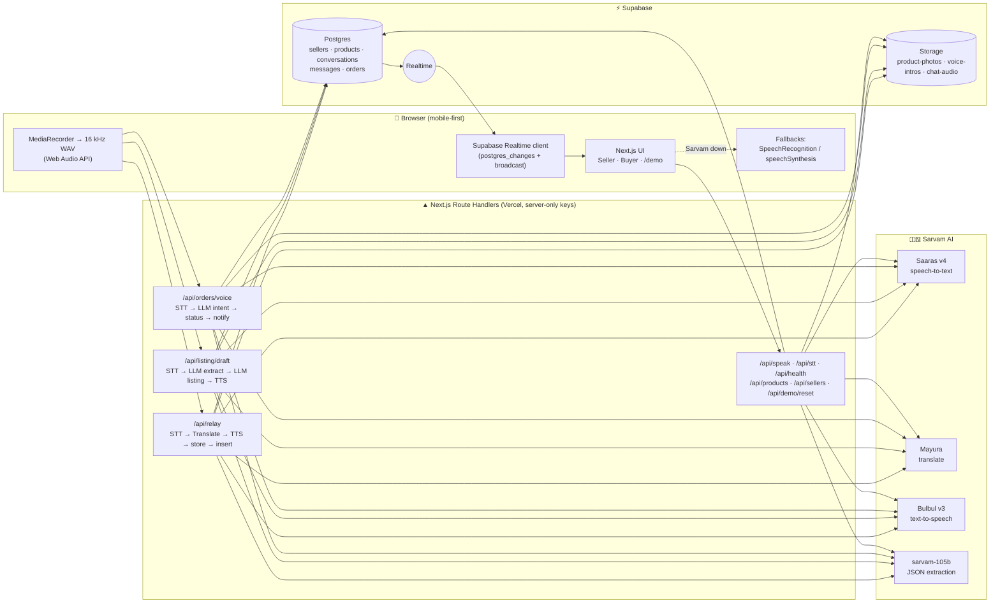

# 🎙️ Bol Bazaar

**Sell anywhere in India, just by speaking.**

## ⚡ Quick start

```bash
git clone https://github.com/nivedhitaramu/bol-bazaar && cd bol-bazaar && docker compose up --build
```

→ open **http://localhost:3000**. Works with **no API keys** (demo mode). Optional: copy `.env.example` to `.env.local` for full AI.

**Without Docker** (Node 20+):

```bash
npm install && npm run dev
```

> **Demo mode (no keys):** the app runs on a built-in, pre-seeded in-memory store (Meena, Ramesh, 4 products, a Hindi⇄Tamil conversation and an order). Speech uses the browser's own speech recognition and voices. Translation uses a built-in Tamil⇄Hindi⇄English phrase dictionary that covers the demo conversation; other phrases show the original text tagged *"Translation key not set"*. Listing extraction and voice order commands use rule-based parsing. Chat between two browser tabs works via polling. A thin banner says demo mode is on, and **`/api/health`** shows exactly which fallback each service is using.
>
> **Full mode:** add the keys from `.env.example`. For `npm run dev`, put them in `.env.local`. For Docker Compose, put them in a file named **`.env`**, which Compose reads automatically, then re-run `docker compose up --build`. Speech recognition and voices for 9 Indian languages, translation and the LLM then come from Sarvam AI, with Supabase for data, storage and realtime.
>
> 🎙️ Browsers only allow the microphone on **https** or **localhost**, so use `http://localhost:3000` (not your LAN IP). Voice input is best in Chrome or Edge.

Bol Bazaar is a voice-first marketplace for India's small sellers (artisans, home cooks, weavers, potters). A seller lists a product by *talking* about it in their own language. A buyer in another state can then talk to the seller live, and each side hears the other **in their own language**.

> 🏆 Built for **India Runs on Voice** (Scaler × Wispr), **Small Business track**.

---

## The problem

Meena has woven Kanchipuram silk sarees for 20 years. Her work is exquisite, but she only speaks Tamil, she isn't comfortable typing, and every e-commerce app asks her to fill in long English forms. Her buyers are in Lucknow, Pune and Kolkata, and they don't speak Tamil.

So Meena sells through a middleman, who keeps most of the margin. India has **tens of millions** of Meenas. The barrier for them isn't the product. It's the **keyboard and the language**.

## The solution

Bol Bazaar removes both.

| Seller says… | Bol Bazaar does… |
|---|---|
| *"இது காஞ்சிபுரம் பட்டுப் புடவை, விலை எட்டாயிரத்து ஐநூறு ரூபாய், மூன்று பீஸ் இருக்கு…"* | Transcribes it, extracts **only what she said** (name, material, price ₹8,500 **exactly**, quantity 3, story), writes a listing in **English, Hindi and Tamil**, and **reads it back to her** in Tamil. |
| *"விலையை 8000 ஆக மாற்று"* ("change price to 8000") | Applies the edit, re-renders and reads it back. |
| Taps **Publish** | She gets a shareable link and a **Share on WhatsApp** button. |
| A Hindi buyer in Lucknow asks *"क्या थोड़ा कम हो सकता है?"* | Meena **hears it in Tamil**, replies by voice in Tamil, and the buyer **hears it in Hindi**, in about 3 seconds. |
| *"ஆர்டரை உறுதி செய்"* ("confirm order") | The order status updates, and the buyer gets a **spoken Hindi update** in the chat. |

## ✨ Key features

- **🏪 Speak your shop online** (`/seller/shop-setup`): one mic, up to 60 seconds. *"I am Meena, I weave Kanchipuram silk for 20 years, my sarees start at 5000…"* turns into a storefront in Tamil, Hindi and English. The screen walks through **Listening → Understanding → Writing in 3 languages → Your shop is live!** and then reads back in her language: *"Your shop is live. Share it on WhatsApp?"* Only what she said is extracted; anything missing is highlighted in yellow so she can fill it by voice.

- **🎤 List by voice**: photo, speak, then a structured listing in 3 languages, with fields that weren't said **highlighted in yellow** (never invented).
- **🔢 Exact numbers**: understands *lakh*, *hazaar*, *ஆயிரம்*, "8.5k" and digits in any script. A deterministic guard makes sure a price the seller actually said is **never altered** by the LLM.
- **🗣️ Voice edits**: "change price to 8000", "add: available in red".
- **💬 Live cross-language chat** (the demo moment): Supabase Realtime, auto-play in the listener's language, "Listening… / Translating… / Speaking…" states shown to *both* sides, a per-message latency badge, original text shown under each translation, and a replay button.
- **🎧 Hear the maker**: a trust feature. The buyer hears the artisan's **own voice**, then the same intro translated into their language.
- **📦 Voice order management**: "confirm order", "ship tomorrow", "shipped" in any language, mapped to an order with a translated, spoken notification to the buyer.
- **🖥️ /demo**: Tamil seller and Hindi buyer **side by side on one screen**, with a one-click **Reset demo**.
- **🌐 9 languages**: Tamil, Hindi, English, Telugu, Kannada, Malayalam, Bengali, Marathi, Gujarati. Core UI is fully translated into Tamil and Hindi.
- **🛟 Works even when AI is down**: browser speech recognition and speech synthesis take over, and rule-based extraction keeps listings and order commands working. A small toast tells the user; nothing crashes.

## 🏪 Speak your shop online

1. Open **`/demo`** and click **Speak your shop**. You're signed in as Meena automatically.
2. Tap the big mic and talk for up to 60 seconds, in any language.
3. Watch **Listening → Understanding → Writing in 3 languages → Your shop is live!**. You'll hear "Your shop is live. Share it on WhatsApp?" in Tamil, with a share button.
4. Open the storefront at `/shop/<sellerId>`. It has a hero with the shop name and story, **Hear the maker**, a WhatsApp button, the products, and a **தமிழ் / हिन्दी / English** switch that changes all of the storefront text.

How it works:
- **Speech-to-text:** recordings up to 60 s are split into chunks of 25 s or less (Sarvam's REST limit is 30 s) and transcribed in parallel.
- **Extraction:** `{shop_name, owner_name, city, craft, years_of_experience, story, specialties[], price_range}` is extracted with zod validation. A rule-based guard keeps spoken prices and years exact: "ஐயாயிரம் ரூபாய் முதல்" becomes "From ₹5,000".
- **Writing the copy:** English copy is written from those facts only, then translated with the protected pipeline (names, numbers, glossary, back-check).
- **Prices and years:** they use fixed templates in each language, so they never pass through machine translation.
- **Shop names:** they're transliterated rather than translated (மீனா சில்க்ஸ் → Meena Silks → मीना सिल्क्स).
- **Without keys:** rule-based extraction plus offline templates. Her own words appear in her language, and Meena and Ramesh have pre-written storefronts.
- **Supabase:** run `supabase/migrations/0002_shop_profile.sql`, which adds the `sellers.shop` column. Until then, publishing returns a friendly "migration needed" message and storefronts still render.

## 🎬 The demo moment (60 seconds)

1. Open **`/demo`** on a laptop and tap **"Tap to enable sound"**.
2. **Right panel (Priya, Hindi):** tap 🎤 and say *"नमस्ते, क्या यह साड़ी लाल रंग में मिलेगी?"*
3. **Left panel (Meena, Tamil)** shows "Priya: Listening…", then the message arrives and is **spoken in Tamil**.
4. Meena taps 🎤 and says *"ஆமாம், சிவப்பு நிறத்தில் இருக்கிறது, விலை எட்டாயிரத்து ஐநூறு"*. Priya **hears it in Hindi**.
5. Meena uses the **order mic** and says *"ஆர்டரை உறுதி செய்"*. Priya's order tracker flips to **Confirmed** and she hears *"आपका ऑर्डर पक्का हो गया है"*.

Want it on two real devices? Click **"Buyer on phone"** in the demo header (or open `/chat/<id>?as=buyer` on a phone).

## 🏗️ Architecture



**Why one `/api/relay` route?** Every chat message makes exactly one round trip from the browser. The server runs STT, translation, TTS, the Storage upload and the DB insert. The insert fans out over Realtime, and the other device auto-plays `audio_url`. Each sent message shows its end-to-end time (⚡ 2.8s) so you can see the latency target being hit.

**Grounded extraction.** Prompts in `lib/llm.ts` say *"extract only what was said, null if not said"*. Output is parsed with **zod**, and `lib/numbers.ts` acts as a deterministic exactness guard: if the transcript contains one explicit currency amount, that number wins over the LLM's output.

## 🎯 Translation accuracy

A wrong price or name breaks trust, so every message goes through `lib/translate/` before the other person hears it:

| Step | What it does |
|---|---|
| **Source language** | Uses the language STT detected for that utterance. Typed text is identified by its script, and Latin text goes to Sarvam `/text-lid`, which tells English apart from romanized Tamil or Hindi. |
| **Romanized → native** | "Order confirm pannu, naalaikku ship pannuven" is turned into Tamil script with Sarvam `/transliterate` before translating. Measured: sarvam-translate garbled the romanized form but translated the native form correctly. |
| **Protect** | Names (Meena, Priya, Kanchipuram, Lucknow…) are replaced with `⟦n⟧` tokens and restored **in the reader's script** (Lucknow becomes लखनऊ or லக்னோ). Spoken numbers become **exact digits** before translation ("எட்டாயிரத்து ஐநூறு" becomes 8,500), and digits and phone numbers pass through unchanged. |
| **Model** | **sarvam-translate:v1**: all 22 languages and the most accurate in our tests, with a respectful register (आप / நீங்கள் forms). **mayura:v1** is the fallback. Mayura's colloquial modes leaked English ("saree eight thousand five hundred rupees") and once flipped "I have" to "I need", so they aren't used. |
| **Glossary** | saree, zari, handloom, terracotta, pickle, silk, order, delivery and COD stay consistent ("आदेश" becomes "ऑर्डर", "saree" becomes "साड़ी"). The glossary is applied *after* translation, because tokenizing common nouns broke the grammar. |
| **Back-check** | Every number in the source must appear in the output, as digits or words. If one is missing, the pipeline retries with the other model and then with full token masking. If it's still missing, the message is delivered with a **⚠ check** badge and the original shown underneath. A wrong number is never sent silently. |
| **Cache** | Identical (masked) text is never translated twice. A repeat takes about 2 ms instead of about 1.5 s. |

Why digits rather than `⟦n⟧` tokens for numbers? We measured it on the live API. "இந்த புடவை ⟦1⟧ ரூபாய், ⟦2⟧ இருக்கு" came back as "…⟦2⟧ **रुपये**": the quantity 2 turned into "2 rupees". With digits, the model kept both the value and the meaning: "इस साड़ी की कीमत 8,500 रुपये है और इसमें 2 हैं।" Tokens remain the third retry strategy.

```bash
npm test                  # 12 unit tests for protection, restore, back-check, glossary, dictionary (offline)
npm run translate:demo    # runs the 3 accuracy sentences through the live pipeline (or --offline)
```

## 🧰 Tech stack

- **Next.js 15** (App Router, Route Handlers), **TypeScript**, **Tailwind CSS v4**
- **Sarvam AI**: Saaras v4 (STT, code-mixed), Mayura (translate), Bulbul v3 (TTS), sarvam-105b (LLM, JSON mode)
- **Supabase**: Postgres, Storage, Realtime (`postgres_changes` + broadcast for live status)
- **zod** for strict LLM output validation, **lucide-react** icons, **Noto Sans** (Tamil/Devanagari/Telugu/Kannada/Malayalam/Bengali/Gujarati) + **Baloo 2**

```
app/            routes: /, /shop, /shop/[sellerId], /product/[id], /seller, /seller/new,
                /seller/onboard, /chat/[conversationId], /demo, /api/*
components/     MicButton, VoiceCapture, ChatPanel, HearTheMaker, OrderVoiceCommand, …
lib/sarvam.ts   all Sarvam calls: typed, timeouts, retries (429/5xx), speaker fallback
lib/llm.ts      extraction / listing / edit / order-intent prompts + zod + heuristic fallbacks
lib/numbers.ts  Indian number parsing (lakh, hazaar, எட்டாயிரத்து, native digits), number spans, back-check
lib/translate/  accuracy pipeline: detect → transliterate → protect → translate → restore → glossary → back-check → cache
tests/          node:test unit tests (npm test)
lib/supabase/   browser client (publishable key) + server admin client (secret key)
lib/client/     recorder hook, WAV encoder, audio player/queue, realtime registry
supabase/migrations/0001_init.sql   schema, RLS, Realtime publication, Storage buckets
scripts/seed.ts                     npm run seed
```

## 🚀 Setup

### 1. Install

```bash
npm install
cp .env.example .env.local     # Windows PowerShell: Copy-Item .env.example .env.local
```

### 2. Environment variables (`.env.local`)

| Variable | Where to find it |
|---|---|
| `SARVAM_API_KEY` | [dashboard.sarvam.ai](https://dashboard.sarvam.ai) → API keys |
| `NEXT_PUBLIC_SUPABASE_URL` | Supabase → Project Settings → API |
| `NEXT_PUBLIC_SUPABASE_ANON_KEY` | the **publishable** key (`sb_publishable_…`); a legacy anon key also works |
| `SUPABASE_SERVICE_ROLE_KEY` | the **secret** key (`sb_secret_…`); a legacy service_role key also works. **Server only.** |

`NEXT_PUBLIC_SUPABASE_PUBLISHABLE_KEY` / `SUPABASE_SECRET_KEY` are accepted as aliases.

### 3. Database

In the Supabase dashboard, open **SQL Editor**, paste the contents of [`supabase/migrations/0001_init.sql`](supabase/migrations/0001_init.sql), and click **Run**. Then do the same for [`0002_shop_profile.sql`](supabase/migrations/0002_shop_profile.sql), which adds the storefront column used by "Speak your shop online".
(Or use `supabase db push` with the Supabase CLI.) This creates the tables, RLS policies, the Realtime publication for `messages` and `orders`, and the public Storage buckets.

### 4. Seed and run (Supabase mode)

```bash
npm run seed      # Meena (Tamil, Kanchipuram) + Ramesh (Hindi, Khurja), 4 products, 1 conversation, 1 order
npm run dev       # http://localhost:3000
```

Check **http://localhost:3000/api/health**: it pings STT, Translate, TTS, the LLM, the DB and Storage, and reports timings.

> 🎙️ Microphone access needs **HTTPS or localhost**. To test on a phone, deploy to Vercel (or use an HTTPS tunnel).

## 🐳 Docker

`docker compose up --build` builds a multi-stage `node:22-alpine` image (Next.js `output: "standalone"`) and serves it on port 3000.

- **Build time:** no environment variables are needed.
- **Runtime:** the server reads keys when it starts, so you can add them later through `.env` without changing anything else.
- **Secrets stay out of the image:** `.dockerignore` excludes `.env*`, `node_modules`, `.next` and `.git`.

## ☁️ Deploy to Vercel

1. Push to GitHub and choose **Import Project** in Vercel (framework: Next.js, no settings needed).
2. Add the four environment variables above (Production and Preview).
3. Deploy, then open `/api/health` and `/demo`.

All API keys stay server-side in Route Handlers. Only the Supabase URL and the publishable key reach the browser, and those are only used for read-only Realtime subscriptions under RLS.

## 🛟 Reliability and fallbacks

| If… | Then… |
|---|---|
| Sarvam STT fails or the key is missing | The client switches to the browser **SpeechRecognition**; the user sees a toast and taps again |
| Sarvam TTS fails | Browser **speechSynthesis** speaks the text |
| Translation fails | The original text is delivered, with a toast |
| The LLM fails | Rule-based extraction (price, quantity, Indian number words), edits ("change price to …") and order intents in en/hi/ta |
| Realtime can't connect, or Supabase isn't configured | The chat polls a local API every 1.5 s, including live "Listening…" status and order updates (badge shows `SYNC` instead of `LIVE`) |
| Supabase keys missing | A seeded **in-memory store** behind the same `Store` interface (`lib/store/`) serves everything, uploads included |
| Sarvam keys missing | Built-in Tamil ⇄ Hindi ⇄ English phrase dictionary (`lib/dictionary.ts`) for the demo conversation; anything else shows the original text tagged "Translation key not set" |
| The browser blocks autoplay | A one-time **"Tap to enable sound"** gate unlocks audio |

## 🔒 Security notes (hackathon scope)

- There are no user accounts. A seller's identity is kept in `localStorage` on their phone, which is fine for a demo but not production auth.
- RLS allows public **reads** only. All writes go through server routes using the secret key.
- `.env.local` is git-ignored. `.env.example` contains no secrets.

## 🗣️ Built by voice with Wispr Flow

Much of this project, including the prompts, the copy and this README, was dictated with **Wispr Flow**. A voice-first product, built by voice.

---

**Hackathon:** India Runs on Voice (Scaler × Wispr), Small Business track
**Author:** Nivedhita R · GitHub [@nivedhitaramu](https://github.com/nivedhitaramu)
